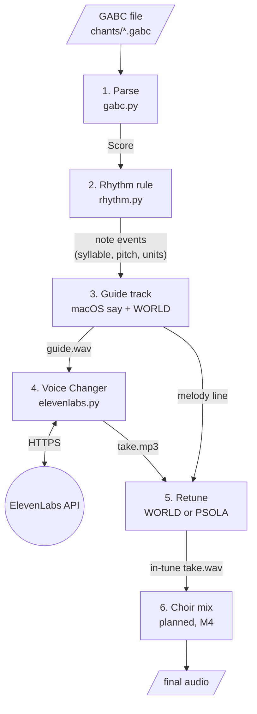

# Design

neuma reads Gregorian chant in GABC notation and makes ElevenLabs voices sing it.

ElevenLabs has no endpoint that accepts a melody, so neuma builds a rough sung
"guide" locally, has Voice Changer re-voice it, and then corrects the pitch of
what comes back. Only one step talks to ElevenLabs.

## Pipeline

| # | Step | Code | Input | Output | Status |
|---|---|---|---|---|---|
| 1 | Parse | `src/neuma/gabc.py` | GABC text | `Score`: syllables of notes at notated pitch, and bar lines | done, tested |
| 2 | Rhythm rule | `src/neuma/rhythm.py` | `Score`, transposition | list of `NoteEvent(syllable, midi, units)`, rests included | done, tested |
| 3 | Guide track | `experiments/m0_refrain.py` | syllables, pitches, lengths | `guide.wav`, the melody line, note timings | experiment; refrain is hand-coded, not yet fed by steps 1-2 (M2) |
| 4 | Voice Changer | `src/neuma/elevenlabs.py` | `guide.wav`, voice id | `take.mp3` in the chosen voice | done, tested |
| 5 | Retune | `experiments/m0_retune.py` | `take.mp3`, melody line | `take.wav`, in tune | experiment (M3 makes it a module) |
| 6 | Choir mix | - | several retuned takes | one mixed file with reverb | planned (M4) |

## How each step works

**1. Parse.** GABC letters are staff positions, so they become pitches only once
the clef is known. The parser resolves clef and accidentals to MIDI numbers and
keeps the rhythmic signs (dot, episema, quilisma) as flags on each note.

**2. Rhythm rule.** Chant has no meter. Every note is one unit; a dot doubles it,
an episema or a following quilisma makes it 1.5; bar lines become breaths or
rests. The table is in the module docstring.

**3. Guide track.** Voice Changer takes audio only, no text, so the guide must
carry the words.

- Each syllable is spoken by a macOS Italian voice (`say`), which is free.
  Church Latin is pronounced like Italian.
- The WORLD vocoder splits each syllable into onset consonants, vowel and tail,
  stretches only the vowel to the note lengths, and replaces the spoken pitch
  with the melody.
- The melody line is the stepped note pitches passed through a second-order
  low-pass filter, which joins notes with a short glide (80 ms by default).

**4. Voice Changer.** The one network step. It returns the guide in a real
voice, with timing kept exactly, but with pitch 300-700 cents off: the model
treats pitch as intonation, not melody.

**5. Retune.** Because timing survives, the melody can be put back. The gentle
variant moves the take only by its slow pitch error (anything slower than
150 ms) and leaves the voice's own fast movement alone, which sounds less
robotic than imposing the melody line outright.

## ElevenLabs API

All calls are in `src/neuma/elevenlabs.py`. The key is read from the
`ELEVENLABS_API_KEY` environment variable and sent as the `xi-api-key` header.

| Call | Purpose | Cost |
|---|---|---|
| `POST /v1/voice-changer/{voice_id}` | re-voice the guide | 1,000 credits per minute of input |
| `GET /v1/voices` | list usable voices | free |
| `GET /v1/user/subscription` | read remaining quota | free |

The Voice Changer request is multipart: the guide as `audio`, plus `model_id`
(`eleven_multilingual_sts_v2`), `seed` and optional `voice_settings`. The
response body is the audio itself, MP3 at 44.1 kHz, 128 kbps (the best format
the free plan allows without restrictions).

Two guards sit in front of the network:

- **Cache.** The request is hashed (SHA-256 over the audio bytes and every
  parameter). If that hash is on disk, the file is returned and nothing is sent.
- **Credit cap.** Each client has a `max_credits` budget. A call whose estimated
  cost would exceed it raises before any request is made.

## Files on disk

Nothing below is committed; `.cache/`, `out/` and `.env` are git-ignored.

| Path | What | Format |
|---|---|---|
| `.cache/say/<hash>.wav` | one spoken syllable per file | WAV, 22.05 kHz, 16-bit mono |
| `.cache/elevenlabs/<hash>.mp3` | a Voice Changer response | MP3, 44.1 kHz, 128 kbps |
| `.cache/elevenlabs/<hash>.json` | the request that produced it, estimated credits, timestamp | JSON |
| `out/m0/guide.wav` | guide track | WAV, 22.05 kHz, 16-bit mono |
| `out/m0/pitch.npy` | intended melody in Hz, one value per 5 ms | NumPy array |
| `out/m0/notes.json` | start, end, pitch and syllable of every note | JSON |
| `out/m0/sung-*.mp3` | copy of a Voice Changer take | MP3 |
| `out/m0/sung-*-<variant>.wav` | retuned take | WAV, 44.1 kHz, 16-bit mono |

The caches are keyed by content, so they are safe to delete: spoken syllables
are regenerated for free, Voice Changer takes cost credits again.

## Known limits

- Voice Changer does not preserve pitch, so step 5 is required, and it costs
  some naturalness: the result is in tune but still closer to robotic than human.
- The guide's speech source is macOS-only.
- Pitch measurement near consonants is unreliable; tuning figures are medians
  over the middle of each note.
